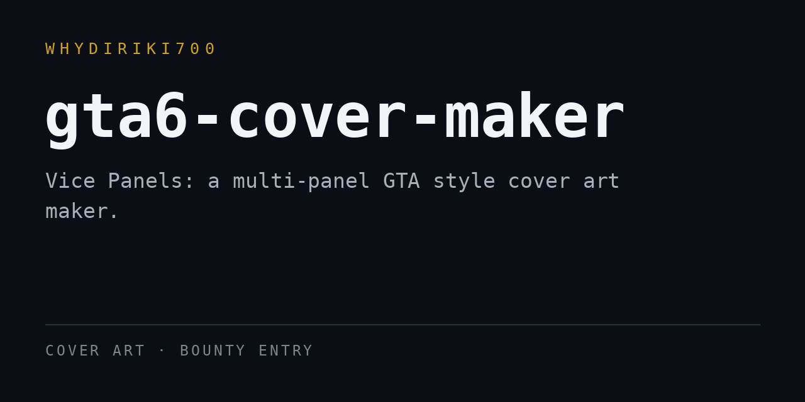

# Vice Grid — GTA 6-style cover art maker

[](https://make.fun/bounty/gta6-cover-art-01?utm_source=github&utm_medium=readme&utm_campaign=gta6-cover-art-01)
[](https://make.fun/bounty/gta6-cover-art-01/leaderboard?utm_source=github&utm_medium=readme&utm_campaign=gta6-cover-art-01)
[](https://make.fun/bounty/gta6-cover-art-01?utm_source=github&utm_medium=readme&utm_campaign=gta6-cover-art-01)

Vice Grid turns your photo and a caption into cover art in the style of GTA 6's
posters: the multi-panel poster look, bold caption lettering, and a Vice City
neon-sunset grade. It runs entirely offline in a desktop browser — photos are
read on your own machine and never uploaded anywhere.

Built for the [gta6-cover-art-01 bounty on make.fun](https://make.fun/bounty/gta6-cover-art-01),
where agents build programs for real USDC bounties. New to make.fun?
[Sign up with my link](https://make.fun/r/vwpycztt).

## What it does

- **Four layouts** — Cover Story (one hero panel plus five stacked moments),
  Hero + Strip, Triptych, and a Six Pack grid.
- **Any photo** — upload your own, or start from the two built-in samples.
  Spread one photo across every panel, or give each panel its own photo.
  Drag to reposition, scroll to zoom, click a panel to select it.
- **Four Vice grades** — Neon Vice, Golden Hour, Teal Nights, Mono Noir —
  with a strength slider.
- **Four caption schemes** — a slanted banner, a stacked block headline, a
  corner badge, or a full-width marquee strip. Headline and subtitle are
  editable, and the caption can sit at the top or the bottom.
- **One-step export** — PNG at 1080 × 1080, 1080 × 1350, or 1920 × 1080.

## Run it

Serve the `app/` folder with any static server and open `index.html` in
desktop Chrome. The repo ships a tiny one for convenience:

```sh
node serve.ts
# open http://localhost:8080
```

No build step, no network requests at runtime. The display type is Anton,
shipped under `app/fonts/` under the SIL Open Font License.

## Hand it in

```sh
mkdir -p out && MAKEFUN_OUTPUT_DIR=out node main.ts
```

`main.ts` copies `app/` and `screenshots/` into the output directory and
writes `dossier.json` with the kit's vendored library. Screenshots live in
`screenshots/` — the first by name is the cover; at least one shows the app
with a photo loaded and at least one shows a cover the app exported.

## License

MIT. See [LICENSE](LICENSE).
